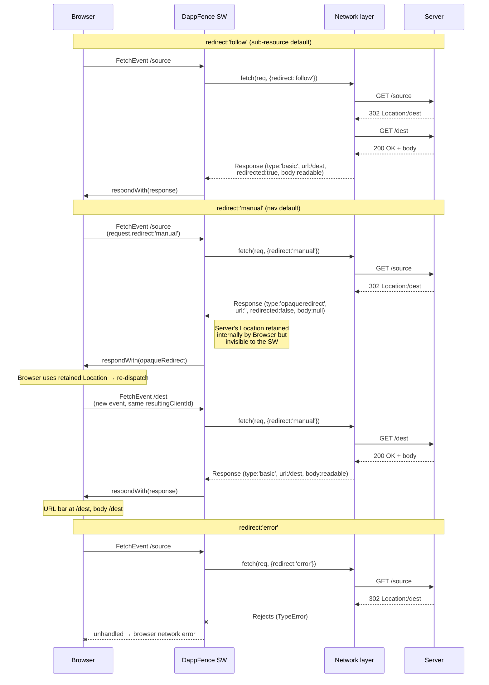

# Redirect Handling

How DappFence handles HTTP 3xx responses — across navigation and sub-resource requests, with and
without a child service worker in play. Captures the design decisions, the browser mechanics that
force them, and the quirks that come out of the combination.

## Why this is complicated

Four things conspire to make redirect handling non-trivial:

1. **The browser hides information from the SW on purpose.** For navigation requests,
   `fetch(req, {redirect:'manual'})` returns an opaque-redirect filtered response with `url:''`,
   `body:null`, `headers:[]`. We cannot read where the server wanted to send us. This is, by spec,
   intended to prevent SWs from being used as navigation fingerprinting oracles.
2. **The browser's URL-bar semantics constrain what we can return.** If we `respondWith` a 200
   containing the destination's body, the URL bar stays at the original URL — a lie that breaks
   reload, bookmarks, `document.URL`, SPA routers, and relative-URL resolution.
3. **Child SWs can call `fetch` with any redirect mode they want.** `redirect:'manual'` on a
   sub-resource normally doesn't happen (browser default is `follow`), but child SWs can force it —
   producing opaque-redirect for a response path that doesn't survive it (sub-resource consumers
   treat opaque-redirect as a network error).
4. **A compromised origin can issue arbitrary Location headers**, including cross-origin ones.
   Protecting against this is the primary attack we care about; everything else is accommodation.

The design has to thread all four needs: respect browser invisibility, preserve URL bar correctness,
cope with child-SW redirect-mode choices, and defend compromised-origin Location forging.

## Browser mechanics primer

### Fetch redirect modes and what each returns on 3xx



Key observable fields across the three modes:

| Field                 | `follow` + 3xx   | `manual` + 3xx     | `error` + 3xx |
| --------------------- | ---------------- | ------------------ | ------------- |
| `response.type`       | `'basic'`        | `'opaqueredirect'` | — (rejects)   |
| `response.status`     | 200 (final)      | 0                  | —             |
| `response.url`        | final URL        | `''`               | —             |
| `response.redirected` | `true`           | `false`            | —             |
| `response.body`       | readable         | `null`             | —             |
| `response.headers`    | final response's | empty              | —             |

### Synthesized 302 from the SW

The SW can also return `respondWith(new Response(null, {status:302, Location:/dest}))` without
touching the network. The browser treats it the same as an opaque-redirect from a real server 302 —
URL bar updates to `/dest`, new FetchEvent dispatches. This is the primary mechanism used to
synthesize redirects from the manifest.

### What a `<script src>` sees

Subresource consumers can't handle opaque-redirect: an opaque-redirect reaching a `<script>` tag is
treated as a network error, and the script simply fails to load. A materialized 302 from the SW
(`new Response(null, {status:302, Location:/dest})`) _is_ followed by the browser for sub-resources
with the default `redirect:'follow'`, and the final body is handed to the script tag.

## Attack surface

What a compromised origin can do with 3xx:

| Attack                                                                                       | Browser outcome without DF                                                                               | What DF must prevent                                                              |
| -------------------------------------------------------------------------------------------- | -------------------------------------------------------------------------------------------------------- | --------------------------------------------------------------------------------- |
| Server redirects known-hashed path `/app.js` → attacker-crafted body at `/evil.js`           | Script loads attacker body (hash of `/alias.js` is never checked because the browser follows internally) | Verify what actually reaches the consumer against the destination's manifest hash |
| Server redirects nav `/` → `attacker.com/evil`                                               | Browser navigates cross-origin; user leaves origin                                                       | Prevent unauthorized cross-origin exit                                            |
| Server redirects known-hashed nav `/dashboard` → `/some-other-known-path` (both in manifest) | Browser renders the destination                                                                          | Semantically fine — but we need manifest-driven choice, not server-driven         |
| Child SW synthesizes `new Response(null, {status:302, Location:'attacker.com'})`             | Browser follows                                                                                          | Treat child-SW materialized 3xx with the same scrutiny as server opaque-redirect  |

The forcing-function principle: redirects become explicit, auditable manifest declarations. Attacker
who compromises the origin cannot introduce new redirect sources (not in the signed manifest) or
change where declared sources go (we overwrite Location from the manifest).

## Design

### `manifest.redirects` schema

```json
"redirects": [
  {
    "from": "/old-faq",
    "to": [
      "/help"
    ]
  },
  {
    "from": "/dashboard",
    "to": [
      "/login"
    ]
  },
  {
    "from": "/submit",
    "to": [
      "/thanks"
    ],
    "status": 303
  },
  {
    "from": "/api/v1/x",
    "to": [
      "/api/v2/x"
    ],
    "status": 308
  },
  {
    "from": "/go-partner",
    "to": [
      "https://partner.com"
    ]
  }
]
```

| Field    | Required | Notes                                                                                    |
| -------- | -------- | ---------------------------------------------------------------------------------------- |
| `from`   | yes      | Exact-match path (same-origin only — no wildcards)                                       |
| `to`     | yes      | Array of allowed destinations. One entry today — see Limitations                         |
| `status` | no       | HTTP status for synthesized redirect. Default `302`. Supports `301`, `303`, `307`, `308` |

### Limitations

-   **One destination per source.** When a source legitimately picks from a set at runtime (auth
    gate: `/dashboard` → `/login` OR `/dashboard-home`; A/B flags; per-user landing pages), the
    manifest cannot express that today. Each `from` must map to a single `to`. Dynamic destination
    sets would need a probe (fetch the source with `follow` to learn the server's pick, then verify
    the pick is in an allowed set) — carries double round-trip cost and drift risk between probe and
    the browser's actual follow.
-   **No `from` wildcards.** Each source needs its own entry.
-   **Streaming POST + method-preserving redirects (307/308) are not expressible.** A request body
    stream can only be consumed once; verifying the destination before letting the browser follow
    would consume it, leaving nothing for the browser's re-fetch.
-   **Child-SW fetch tampering is a separate concern** (see §Child-SW fetch control below). The
    schema's guarantees assume the response shapes DF expects per request kind; a compromised child
    SW can flip them. Addressed by a separate hardening, not by this schema.

Validation rejects:

-   `javascript:` / `data:` schemes in `to` entries
-   Duplicate `from` keys
-   `to` entries that resolve to loops (`from === to`)
-   `to.length > 1` (see Limitations above)

### Risks of declaring external (cross-origin) `to` destinations

Declaring `{from:'/go-partner', to:['https://partner.com']}` is legal and sometimes necessary. It
carries a specific risk profile integrators must understand:

| Risk                                                                     | Severity                  | Mitigation                                                                                       |
| ------------------------------------------------------------------------ | ------------------------- | ------------------------------------------------------------------------------------------------ |
| Supply chain: declared destination later compromised                     | high (out of DF scope)    | Treat each cross-origin `to` as a supply-chain dep; review on manifest sign                      |
| Open-redirect chain: `partner.com` has its own open redirect to attacker | medium                    | Prefer `to` entries pointing at specific pages (`https://partner.com/landing`), not domain roots |
| Session cookie exfiltration on landing                                   | user-config-dependent     | SameSite=Strict/Lax on sensitive cookies (DF doesn't control)                                    |
| Scheme downgrade: dev writes `http://` instead of `https://`             | high                      | Loader warns (not rejects — some integration tests need http for proxy fixtures)                 |
| Typo-squatting / punycode: `partńer.com` instead of `partner.com`        | medium                    | Manual review on sign; validator could warn on mixed-script hostnames                            |
| No TTL: compromised destination stays in signed manifest                 | low–medium                | Manifest history makes this stickier than browser cache; keep sign-cycle responsive to incidents |
| DF has no reach after hand-off                                           | documented scope boundary | User is on the external origin's security posture from that point                                |

**What external `to` does NOT add vs same-origin `to`:** the forcing-function property is identical
— a compromised server still can't change the destination because DF overwrites `Location` from the
manifest. The difference is purely downstream of the hand-off.

### Child-SW fetch control

The schema above assumes a fixed contract about what response shape DF sees per request kind: nav →
opaque-redirect on 3xx (URL bar correct); sub-resource → basic+redirected on 3xx (manifest-key via
`response.url` works). A compromised child SW can break either direction by passing an explicit
`redirect` init that flips the shape — demonstrated by probes in `sw-child-fetch.spec.ts`:

-   Child does `fetch(req, {redirect:'follow'})` on a `navigate` request → DF sees a basic 200 under
    the source URL (URL-bar breakage with destination body).
-   Child does `fetch(req, {redirect:'manual'})` on a sub-resource → DF sees opaque-redirect at a
    script tag (network error).

The planned hardening patches `self.fetch` via the existing `monkeyPatch` helper. The enforcement
policy per request kind is a choice we deliberately leave open until the phase lands — the design
space is:

| Request kind                                            | Options to pick from                                    | Trade-off                                                                                               |
| ------------------------------------------------------- | ------------------------------------------------------- | ------------------------------------------------------------------------------------------------------- |
| `req.mode === 'navigate'`                               | force `'manual'` OR force `'error'`                     | `manual` fits the uniform classifier model; `error` forces active synthesis (no lazy pass-through path) |
| known sub-resource (destination executable / fetchable) | force `'follow'`                                        | Preserves `response.url` → manifest-key verification path                                               |
| anything else (unexpected mode)                         | **block** — return a synthetic error / warning response | Safety fallback: unanticipated kinds don't become bypass paths                                          |

Discipline that holds regardless of which options we pick:

-   Patch `self.fetch` — child SWs call this directly (`fetch(...)`)
-   Do NOT patch `swContext.fetch` — our outer SW's own fetches keep their original behavior
-   Consider `secureMonkeyPatch` for anti-tampering (non-writable descriptor so an
    attacker-controlled child SW can't restore the original). Trade-off: the patch can't be undone
    in tests. Start with `monkeyPatch`; promote if the threat model justifies losing test-restore
    ergonomics.

## Known quirks

1. **URL bar transition requires to be synthesized 302 for nav.** Returning a 200 with the
   destination's body would leave the URL bar at the source. Only
   `respondWith(new Response(null, {status:302, Location:...}))` triggers the browser's URL-bar
   update.
2. **Opaque-redirect reveals nothing to the SW.** `response.url=''`, body null, headers empty. We
   can inspect the source origin but not the `request.url` destination. This is the information gap
   we close with `manifest.redirects` providing the destination.
3. **Materialized 3xx body is discarded by the browser if Location is valid.** Pinning the body hash
   in `files[]` for a redirect source is semantically dead weight — the browser won't look at the
   body when it has a valid Location to follow. This is why we always strip the body when
   re-synthesizing child SW 3xx redirects.
4. **Body IS executable if Location is missing/malformed.** For 3xx without a valid Location, the
   browser may fall back to rendering the body as HTML (historical XSS vector). Our policy: when
   `shouldSkipVerification` sees a 3xx without a valid-scheme Location, treat it as a non-redirect
   and verify the body via the normal path.
5. **303 forces GET on next hop, 307/308 preserve method and body.** Developer's status choice in
   `manifest.redirects` drives this. For PRG patterns (`form POST` → `confirmation page`), declare
   `status:303`.
6. **Multiple destinations per source would require a probe.** Opaque-redirect doesn't reveal which
   allowed destination the server picked. Verifying would need
   `fetch(req.clone(), {redirect:'follow'})` to learn the destination and check it against the
   allowed set — at the cost of an extra destination body transfer. See Limitations.
7. **Streaming POST + method-preserving redirects (307/308) can't be verified ahead of the browser's
   follow.** The request body stream can only be consumed once; a probe would consume it and leave
   nothing for the re-fetch. See Limitations.
8. **Module script `import.meta.url` behavior differs under the child-SW patch.** When a child SW's
   `fetch(req, {redirect:'manual'})` is force-converted to follow by the patch, the module script
   sees `import.meta.url === request.url` (original) rather than the destination URL. Relative
   imports still resolve correctly against this URL. Absolute URL comparisons against
   `import.meta.url` would see the pre-redirect URL. Rare dependency.
9. **Patch detectability and tampering.** `self.fetch.toString()` reveals the patched source. With
   plain `monkeyPatch`, an adversarial child SW could sniff and either hold a reference to the
   original fetch (if it ran before the patch) or restore the descriptor. `secureMonkeyPatch` closes
   the restoration path (non-writable, non-configurable descriptor) but can't hide detection via
   `toString`. Cooperative child SWs (test-app's `sw_app.js`) do not care about either.
10. **Probe may differ from browser's follow.** Session cookies rotated between the probe and the
    browser's follow, server A/B flags flipped, auth state changed — all could make the probe see a
    different destination than the browser's eventual re-fetch would. In practice this window is
    <five secs, and the drift is minimal, but it is theoretically present.
11. **In-memory probe body caching is possible.** The destination body fetched during a
    multi-destination probe is thrown away; the browser's re-dispatch fetches it again. An in-memory
    cache keyed by `resultingClientId + destinationURL` would eliminate the double transfer.
    Deferred as an optimization pending multi-destination usage data.

## Documented limitations (not fixable at origin SW layer)

-   **Compromise of a declared cross-origin destination is out of DF's scope.** If dev declares
    `/go-partner` → `https://partner.com` and partner.com is itself compromised, DF stops being
    relevant at the hand-off point. Standard supply-chain concern.
-   **No CSP directive controls where a server can redirect user navigations to.** `form-action`,
    `connect-src` cover different request shapes; `navigate-to` was proposed and dropped. There is
    no origin-controlled way to constrain server-side nav redirect destinations other than the
    manifest-driven approach described here.
-   **Client-side detection of the destination before redirect is impossible.** `beforeunload`
    doesn't expose the destination; the Navigation API doesn't fire for cross-origin targets.
    Browsers deliberately keep server-initiated navigation destinations opaque to a page script.
